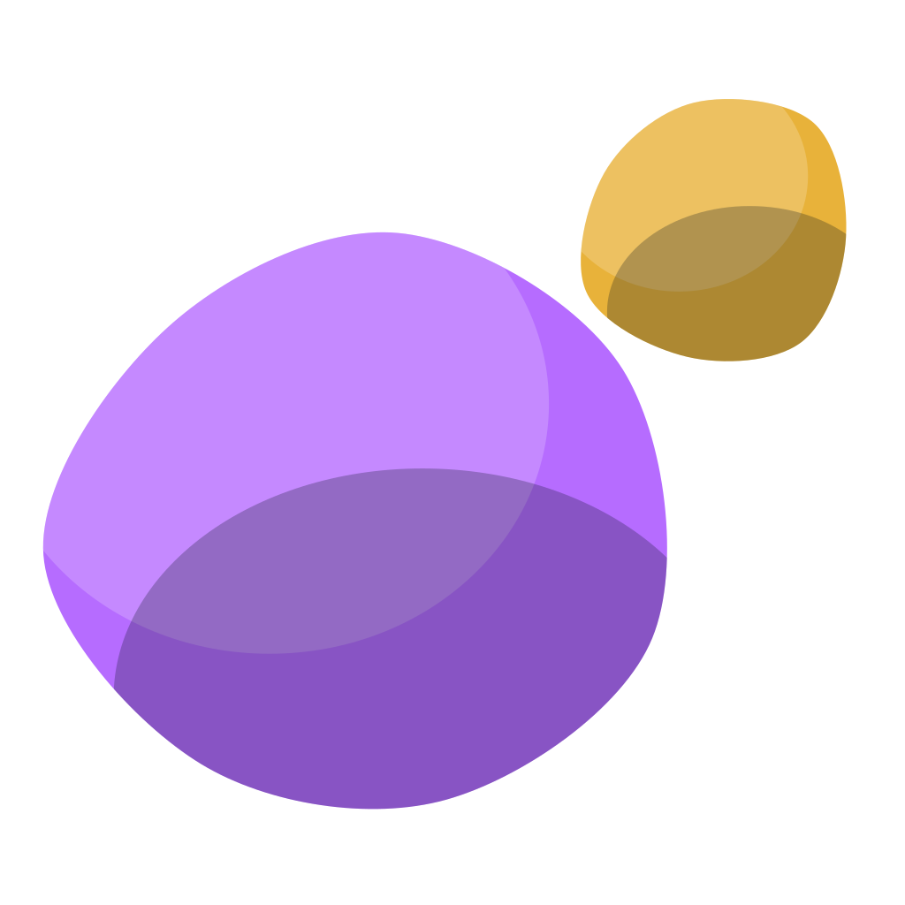
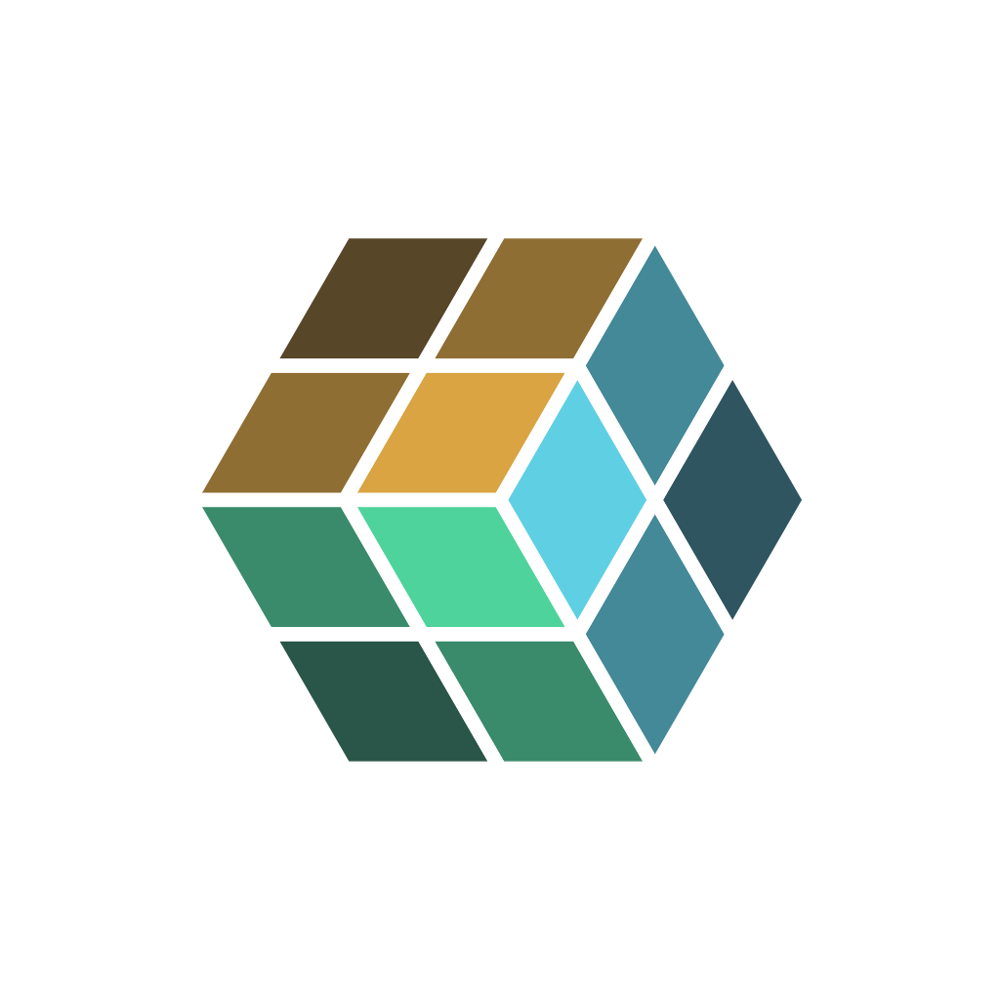

<picture>
  <source media="(prefers-color-scheme: dark)" srcset="assets/banner-dark.svg">
  
</picture>

ArboRithm builds tools to work with AI: steer your projects, give agents a memory that lasts, and let them see and act on your desktop under a ceiling you control. Local-first, open protocols (MCP), no lock-in. All three apps are freeware for macOS and Windows.

**[arborithm.fr](https://arborithm.fr/home/)**

## Projects

<table>
  <tr>
    <td width="96" align="center"></td>
    <td>
      <strong><a href="https://github.com/ArboRithm/Effortless">Effortless</a></strong> — Steer your projects with AI, effortlessly. 
      A framework for AI-assisted project steering: Project, Epic, Story and Task, moved forward through five phases, with an analyst / developer / QA team loop. Local-first desktop app exposing its engine through MCP tools. 
      <a href="https://arborithm.fr/projects/effortless/">Learn more</a> · <a href="https://arborithm.github.io/Effortless/en/">Documentation</a> · <a href="https://github.com/ArboRithm/Effortless/releases/latest">Download</a>
    </td>
  </tr>
  <tr>
    <td width="96" align="center"></td>
    <td>
      <strong><a href="https://github.com/ArboRithm/Daimon">Daimon</a></strong> — See, act, show: any AI on your desktop, safely. 
      One local MCP daemon for macOS and Windows: see the screen, act on it, show what is being done. The hands stay under an L0–L4 ceiling that Daimon enforces itself, never the AI. 
      <a href="https://arborithm.fr/projects/daimon/">Learn more</a> · <a href="https://arborithm.github.io/Daimon/en/">Documentation</a> · <a href="https://github.com/ArboRithm/Daimon/releases/latest">Download</a>
    </td>
  </tr>
  <tr>
    <td width="96" align="center"></td>
    <td>
      <strong><a href="https://github.com/ArboRithm/Kessho">Kesshō</a></strong> — The memory that carries over between sessions. 
      A readable Markdown vault (Obsidian-friendly) that agents write and read through MCP: dated archives and a current context per project, so you find not only what was done, but what was decided and why. 
      <a href="https://arborithm.fr/projects/kessho/">Learn more</a> · <a href="https://arborithm.github.io/Kessho/en/">Documentation</a> · <a href="https://github.com/ArboRithm/Kessho/releases/latest">Download</a>
    </td>
  </tr>
</table>

<strong>Français</strong>

 

ArboRithm conçoit des outils pour travailler avec l'IA : piloter vos projets, donner aux agents une mémoire qui dure, et les laisser voir et agir sur votre bureau sous un plafond que vous maîtrisez. Local d'abord, protocoles ouverts (MCP), sans verrou. Les trois applications sont des gratuiciels pour macOS et Windows.

- **[Effortless](https://github.com/ArboRithm/Effortless)** — Pilotez vos projets avec l'IA, sans effort. · [En savoir plus](https://arborithm.fr/projets/effortless/) · [Documentation](https://arborithm.github.io/Effortless/) · [Télécharger](https://github.com/ArboRithm/Effortless/releases/latest)
- **[Daimon](https://github.com/ArboRithm/Daimon)** — Voir, agir, montrer : toute IA sur votre bureau, en toute sécurité. · [En savoir plus](https://arborithm.fr/projets/daimon/) · [Documentation](https://arborithm.github.io/Daimon/) · [Télécharger](https://github.com/ArboRithm/Daimon/releases/latest)
- **[Kesshō](https://github.com/ArboRithm/Kessho)** — La mémoire qui reste d'une session à l'autre. · [En savoir plus](https://arborithm.fr/projets/kessho/) · [Documentation](https://arborithm.github.io/Kessho/) · [Télécharger](https://github.com/ArboRithm/Kessho/releases/latest)

**[arborithm.fr](https://arborithm.fr/accueil/)**

